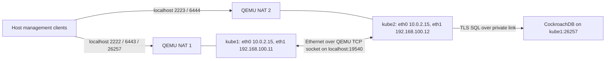

# Disposable Flatcar / CockroachDB / K3s QEMU lab

This lab provisions Flatcar through Ignition, runs secure CockroachDB in a
host Docker container, and runs K3s against that SQL datastore through Kine.
Cilium is installed after the API starts. It uses no embedded etcd, SQLite, or
Flannel. Kube-proxy remains enabled.

The experiment progressed from one node, to two K3s servers sharing one SQL
node, to **three VMs each running CockroachDB and a K3s server**. The three-node
lab preserved the original Kubernetes state and passed the checks below.
The commands in this guide reproduce that progression; the final step is
[expanding the database and Kubernetes cluster to three nodes](#expand-to-three-nodes-with-cockroachdb-on-each).

The host needs x86-64 Linux, access to `/dev/kvm`, Python 3.12+, `curl`,
`ssh-keygen`, SSH, Docker, and `qemu-system-x86_64` / `qemu-img`:

```bash
sudo apt-get update
sudo apt-get install -y --no-install-recommends qemu-system-x86 qemu-utils
```

Run the following from this directory. The VM uses 4 vCPUs, 6 GiB RAM,
and a sparse 40 GiB overlay over an unmodified Flatcar base image.
All VM state, SSH credentials, PKI, Ignition, and kubeconfig live in ignored
`lab/`. The lab creates its own SSH key; no change to `cluster.json` is needed.

```bash
python3 qemu-lab.py prepare
python3 qemu-lab.py start
# First boot downloads the K3s extension and CockroachDB image. Allow a few minutes.
python3 qemu-lab.py ssh 'systemctl is-active cockroachdb; sudo journalctl -u k3s -n 15 --no-pager'
# Retry this SQL command once CockroachDB is listening. It is idempotent.
python3 qemu-lab.py bootstrap-db
python3 qemu-lab.py ssh 'sudo k3s kubectl get nodes'
python3 qemu-lab.py kubeconfig
python3 qemu-lab.py cilium install --version 1.20.4 \
  --set operator.replicas=1 --set kubeProxyReplacement=false \
  --set ipam.operator.clusterPoolIPv4PodCIDRList=10.42.0.0/16 \
  --set cni.binPath=/opt/cni/bin --set cni.confPath=/etc/cni/net.d
python3 qemu-lab.py cilium status --wait --wait-duration 45s --interactive=false
python3 qemu-lab.py smoke
```

The smoke test deploys a small HTTP server and a job in `lab-smoke`. The job
checks Kubernetes DNS and fetches the server through its DNS name and ClusterIP.
Startup retries can leave a failed job pod beside the successful pod; the job
must have condition `Complete`, and successful logs include
`PASS: pod DNS and HTTP through ClusterIP service`.
To run a fresh job after a previous success:

```bash
python3 qemu-lab.py ssh 'sudo k3s kubectl delete job -n lab-smoke dns-http'
python3 qemu-lab.py smoke
```

When upgrading Cilium, repeat `--set kubeProxyReplacement=false`; CLI detection
looks for a kube-proxy DaemonSet and can miss K3s's embedded kube-proxy.
With `flannel-backend: none`, this K3s release leaves CNI directories at
containerd defaults: `/opt/cni/bin` and `/etc/cni/net.d`.

Only localhost ports are forwarded, using QEMU user networking; no host bridge
or firewall changes are needed:

| Host | Guest | Purpose |
| --- | --- | --- |
| 127.0.0.1:2222 | 22 | SSH as core |
| 127.0.0.1:6443 | 6443 | Kubernetes API |
| 127.0.0.1:26257 | 26257 | TLS SQL with lab admin certificate |

For host kubectl, set `KUBECONFIG=$PWD/lab/kubeconfig`.
For guest kubectl, use `python3 qemu-lab.py ssh 'sudo k3s kubectl get pods -A'`.
For SQL, use `python3 qemu-lab.py sql 'SHOW DATABASES;'`.
The CA private key and root client key stay on the management host.

For an interactive shell, run `python3 qemu-lab.py ssh`, `ssh2`, or `ssh3`.
You log in as `core` with passwordless `sudo`. Direct SSH uses the generated
`lab/id_ed25519` key and localhost port 2222, 2223, or 2224 respectively:

```bash
ssh -i lab/id_ed25519 -p 2224 core@127.0.0.1
sudo systemctl status cockroachdb k3s
sudo journalctl -fu cockroachdb
```

Stop gracefully with `python3 qemu-lab.py stop`; wait for `lab/qemu.pid` to
disappear. `start` then reuses the existing disk. Ignition runs only on first
boot; regenerating Ignition does not modify an already provisioned guest.
For a fresh lab, stop it, rename `lab/` to a private backup directory, then run
`prepare` and `start` again. Never reuse these lab credentials for real nodes.

## Add a second Kubernetes server

Two K3s servers can share an external database; there is no requirement to jump
from one to three Kubernetes servers. This lab keeps **one CockroachDB node**
on kube1 and adds a second K3s server with its own certificate-authenticated SQL
connection. This tests joining and cross-node networking, not database HA.

Starting from the running single-node lab with Cilium installed:

```bash
python3 qemu-lab.py add-server
# Allow kube2's first boot and Cilium image downloads to finish.
python3 qemu-lab.py ssh 'sudo k3s kubectl get nodes -o wide'
python3 qemu-lab.py ssh2 'sudo k3s kubectl get --raw=/readyz'
python3 qemu-lab.py cilium status --wait --wait-duration 45s --interactive=false
python3 qemu-lab.py cross-smoke
python3 qemu-lab.py kubeconfig2
```

`add-server` preserves kube1's disk and database. It adds a private NIC to the
running VM, reissues its CockroachDB certificate with the private IP using the
existing CA, updates its K3s advertised address, and restarts CockroachDB/K3s
and the Cilium components. This briefly interrupts the API. Original node
certificates are saved in `lab/pki/kube1/*.before-private-link`.
It then provisions a fresh kube2 disk through Ignition with the same K3s token
and database, a unique Kine client key, and no CockroachDB service/node key.
No second `cockroach init` is run. The second VM uses 2 vCPUs and 3 GiB RAM.

`ssh2` accesses kube2; `kubeconfig2` writes `lab/kubeconfig-kube2`, pointing at
`https://127.0.0.1:6444`. The original `lab/kubeconfig` still points at kube1
through port 6443. Both API servers see the same cluster.

The cross-node test pins a web pod and client job to each node, and verifies
DNS and HTTP through a Service targeting the other node's web pod. Both
directions passed on 2026-10-23; both nodes were Ready, both APIs passed
`/readyz`, and Cilium/Envoy were ready on 2/2 nodes. A job retried once while
its target service was starting. To repeat with fresh jobs:

```bash
python3 qemu-lab.py ssh 'sudo k3s kubectl delete jobs -n lab-cross --all'
python3 qemu-lab.py cross-smoke
```

Stop kube2 with `stop2` before stopping kube1 with `stop`. For a complete VM
process restart, start kube1 with `start` before kube2 with `start2`: the
private socket backend listens in kube1's QEMU process and connects from
kube2's process. If kube1's QEMU process exits, restart kube2's QEMU process
after kube1 to restore the link. Guest OS reboots keep the QEMU processes and
their network link alive. The two-node lab has not undergone a reboot or
failure-injection test.

## QEMU network layout at the two-node stage

Each VM has two NICs. `eth0` connects to a **separate** QEMU user/NAT backend
for downloads and localhost management forwards. Both guests can have the
same NAT address (`10.0.2.15`) because those virtual networks are isolated.
Their default gateway is `10.0.2.2` and NAT DNS is `10.0.2.3`.

The second NIC, matched by MAC in an Ignition-provisioned systemd-networkd
file, connects the VMs through QEMU's TCP socket backend. QEMU on kube1
listens on host **127.0.0.1:19540**; kube2's QEMU connects to it. That TCP
connection carries virtual Ethernet frames, not a Kubernetes API service.
The private subnet has no gateway or DNS server; internet traffic continues
to use eth0. No host TAP interface, Linux bridge, route, or firewall changes
are needed. The host cannot directly route to these private guest IPs.

| Network / endpoint | kube1 | kube2 |
| --- | --- | --- |
| NAT NIC eth0 (separate backends) | 10.0.2.15/24 | 10.0.2.15/24 |
| Private NIC eth1 | 192.168.100.11/24 | 192.168.100.12/24 |
| Private NIC MAC | 52:54:00:ca:00:01 | 52:54:00:ca:00:02 |
| Cilium pod subnet | 10.42.0.0/24 | 10.42.1.0/24 |
| Host localhost SSH port | 2222 → 22 | 2223 → 22 |
| Host localhost API port | 6443 → 6443 | 6444 → 6443 |
| Host localhost SQL port | 26257 → 26257 | none |



K3s advertises the private IPs. Cilium uses VXLAN (UDP 8472) between them for
cross-node pod traffic; kube-proxy remains enabled for service handling.
The Kubernetes service subnet remains `10.43.0.0/16`. Both API endpoints
appear in the `kubernetes` Service, and kube2 connects to
`192.168.100.11:26257` for TLS SQL. Losing kube1 still loses the only database.

## Expand to three nodes with CockroachDB on each

From the running two-node lab, migrate the existing database rather than
initializing a new cluster:

```bash
python3 qemu-lab.py expand-three
# Allow kube3 first boot and Docker image pulls to complete.
python3 qemu-lab.py db-status
# Run after all three database nodes report live.
python3 qemu-lab.py restore-replication
python3 qemu-lab.py cilium status --wait --wait-duration 45s --interactive=false
python3 qemu-lab.py cross-smoke
python3 qemu-lab.py quorum-smoke
python3 qemu-lab.py kubeconfig3
```

`expand-three` provisions kube3 with fresh Ignition, creates the missing unique
node/Kine certificates using the existing CA, enables host-level CockroachDB
on kube2, and changes kube1 from `start-single-node` to `start` with the same
existing data store. All three use the same three-address `--join` list.
Existing kube1/kube2 settings are migrated over SSH and generated Ignition
is updated for review/reprovisioning; Ignition is not rerun on those live disks.
Every K3s server connects to **127.0.0.1:26257** using its own TLS client key.
No `cockroach init` is run during this expansion.

Single-node startup had explicitly set 15 zone configurations to replication
factor 1. `restore-replication` saves the original zone SQL in ignored
`lab/replication-before.csv`, then changes those settings to **3**, preserving
TTL, range sizes, constraints, and lease preferences. It refuses to proceed
unless three database nodes report live. The lab uses RF=3 for system data
as well as user data; the vendor's general example recommends RF=5 for some
system zones. This is a lab choice for exactly three hosts.

The lab reduces each CockroachDB cache and SQL memory budget to **128 MiB**.
VM allocations are 4 vCPUs/6 GiB for kube1 and 2 vCPUs/3 GiB each for kube2/3.
Those small budgets are for this integration experiment, not sizing guidance.

The private Ethernet network now uses QEMU's built-in multicast socket bus:

```text
-netdev socket,id=cluster,mcast=239.192.100.1:19541,localaddr=127.0.0.1
```

All three QEMU processes send/receive virtual Ethernet frames through that
multicast group on **host loopback**. This replaces the two-node TCP link;
no VM is the network switch, no extra switch daemon is needed, and a QEMU
process can restart independently. There is still no TAP, host bridge, or
host route to the private subnet. Each VM keeps its separate NAT NIC for
downloads and localhost port forwarding. The NICs keep the same private MACs
and IPs; kube3 adds MAC `52:54:00:ca:00:03` and IP `192.168.100.13`.

| Endpoint | kube1 | kube2 | kube3 |
| --- | --- | --- | --- |
| Private node IP | 192.168.100.11 | 192.168.100.12 | 192.168.100.13 |
| Pod subnet | 10.42.0.0/24 | 10.42.1.0/24 | 10.42.2.0/24 |
| Host localhost SSH port | 2222 | 2223 | 2224 |
| Host localhost API port | 6443 | 6444 | 6445 |
| Host kubeconfig | lab/kubeconfig | lab/kubeconfig-kube2 | lab/kubeconfig-kube3 |
| K3s SQL endpoint | 127.0.0.1:26257 | 127.0.0.1:26257 | 127.0.0.1:26257 |

Observed on 2026-10-23:

- Three Kubernetes control-plane nodes Ready; all three APIs passed `/readyz`.
- CockroachDB node IDs 1, 2, 3 were live and available in the existing cluster.
  Each held 62 ranges, with zero unavailable and under-replicated ranges after
  RF=3 settled.
- Cilium and Envoy were ready on 3/3 nodes. Fresh DNS/ClusterIP HTTP jobs
  passed across all six directed node pairs.
- With kube1's CockroachDB service stopped, a ConfigMap write through kube2's
  API and read through kube3's API passed. The test restored kube1's service
  in a `finally` block. This tested loss of one database process, not loss of
  an entire VM or workstation.
- Four Python tests passed, including replication-change preconditions and
  preservation of zone settings; Python compilation and whitespace checks passed.

`cross-smoke` now discovers the configured lab nodes and creates one web pod
per node plus a job for every directed pair. Delete its jobs before repeating
to ensure a fresh test. `quorum-smoke` checks that all three database nodes
are live and fully replicated before temporarily stopping kube1 SQL. The
ConfigMap `default/lab-quorum-smoke` remains as test evidence.

For lifecycle operations use `stop`, `stop2`, `stop3` and `start`, `start2`,
`start3`. The multicast bus removes the two-node stage's startup-order
dependency, but the database still needs a majority. Do not stop two database
nodes at once if you want the cluster to remain available. All VMs still run
on one workstation, so this experiment does not provide host-level HA.

## Certificates, trust, and the K3s token

There are **two independent PKIs**: our generated CockroachDB CA, and the
Kubernetes CAs managed by K3s. The CockroachDB CA is not used to sign Kubernetes
API, kubelet, or kubectl client certificates.

### CockroachDB: generated on the management workstation

`prepare` calls `generate.py pki` using the pinned CockroachDB Docker image.
The generator runs `cockroach cert create-ca`, `create-node`, and
`create-client`. The normal three-machine profile uses `pki/`; the QEMU lab
uses **`lab/pki/`**. Initial PKI generation refuses to overwrite an existing
directory. Lab expansion uses the existing CA to issue the missing certificates.

| Management-host file under lab/pki/ | Identity / purpose | Delivered to VMs? |
| --- | --- | --- |
| ca.crt | Public CA certificate trusted for database TLS | Yes, on every node |
| ca.key | Signs database node and client certificates | **No** |
| kubeN/node.crt, node.key | Unique node keypair; SQL server TLS and database peer authentication | Only to kubeN |
| kubeN/client.kine.crt, client.kine.key | Unique keypair per K3s server, all authenticating as SQL user `kine` | Only to kubeN |
| admin/client.root.crt, client.root.key | SQL administrator identity used by host bootstrap/SQL commands | **No** |

Node certificate SANs include the node's configured IP, node name, `localhost`,
and `127.0.0.1`. When kube1 gained its private NIC, the lab reissued its node
certificate to include `192.168.100.11`, retaining its old NAT address as well.
The same database CA and existing Kine client keys were retained during expansion.

Ignition embeds the public CA plus that node's certificate/key files at
**`/etc/cockroach/certs/`**. The CockroachDB container bind-mounts that directory
read-only at **`/cockroach/certs/`**. The node private key is mode `0400`, owned
by UID 1000 so the container's non-root process can read it. The Kine client
certificate/key are mode `0600`, owned by root for the host K3s process.

Each server's `/etc/rancher/k3s/config.yaml` contains:

```yaml
datastore-endpoint: "postgres://kine@127.0.0.1:26257/kubernetes?sslmode=verify-full"
datastore-cafile: /etc/cockroach/certs/ca.crt
datastore-certfile: /etc/cockroach/certs/client.kine.crt
datastore-keyfile: /etc/cockroach/certs/client.kine.key
```

K3s/Kine verifies the SQL server's CA and hostname and presents its client
certificate. `bootstrap.sql` creates the `kine` SQL account and grants it
database/schema privileges; it does not set a SQL password. CockroachDB peer
connections likewise use the generated node certificates with TLS enabled.

### K3s: generated and managed by K3s

Our generator does **not** create Kubernetes certificates. The first K3s
server generates its cluster CAs and certificates. K3s stores authoritative
CA material in encrypted bootstrap data in the shared datastore, with local
TLS files under `/var/lib/rancher/k3s/server/tls/`. Additional servers use the
same datastore and server token to recover that bootstrap material and join
the same cluster. [K3s certificate documentation](https://docs.k3s.io/cli/certificate)

The generator creates a random 256-bit secret in `lab/pki/k3s-token` and
embeds it as `token:` in every server's mode-`0600` K3s configuration. It is
also used to encrypt datastore bootstrap secrets; preserve it with database
backups. K3s writes its secure-format server token at
`/var/lib/rancher/k3s/server/token`. [K3s token documentation](https://docs.k3s.io/cli/token)

Each node's `tls-san` adds its private IP to its API serving certificate.
K3s generates `/etc/rancher/k3s/k3s.yaml` with the API CA and admin client
credentials. Our `kubeconfig`, `kubeconfig2`, and `kubeconfig3` commands copy
those credentials into private host files and select the corresponding
localhost-forwarded API port.

### Inspection and renewal

These inspection commands show certificate metadata rather than private keys:

```bash
# On a VM: database certificates, using root to inspect every installed keypair.
sudo docker exec --user 0 cockroachdb /cockroach/cockroach cert list \
  --certs-dir=/cockroach/certs
# On a VM: Kubernetes certificate status.
sudo k3s certificate check --output table
```

The lab has **no automated CockroachDB certificate renewal or tested rotation
procedure**. Issuing a replacement on the workstation does not update a live
VM automatically; updating Ignition affects future provisioning only. Keep
track of certificate expiry and plan live replacement/reload or restart
separately. See the [CockroachDB certificate documentation](https://www.cockroachlabs.com/docs/v26.2/create-security-certificates-custom-ca).

K3s renews expiring leaf certificates on startup, while CA rotation is a
separate operation. This experiment has not exercised certificate or CA
rotation. Follow the [K3s certificate procedures](https://docs.k3s.io/cli/certificate)
for those operations.

Generated Ignition includes private keys and the K3s token. The host
kubeconfigs carry Kubernetes admin credentials. Keep `lab/` private and
ignored; keep the database CA private key and root client key on the management
host. This section documents the current lab, not a complete backup/rotation
runbook.

## Observed validation, 2026-10-23

- Flatcar **4757.2.2**, image verified against vendor SHA-512 digest.
- CockroachDB **v26.2.7**, TLS server verification and certificate-authenticated
  Kine connection; no insecure mode.
- K3s **v1.35.8+k3s1**, community Flatcar sysext loaded on first boot;
  Kine dependency **v0.16.4**.
- Cilium **1.20.4**, CLI **v0.20.1**, CLI archive verified by SHA-256.
- Node `kube1` reached `Ready`; API `/readyz?verbose` passed every check;
  Cilium, Envoy, operator, CoreDNS, metrics-server, and local-path provisioner ran.
- Pod DNS and service HTTP smoke job passed. Kine's initial 495 revisions were
  observed as IDs 1 through 495, backed by `nextval(kine_id_seq)`.
- Reboot recovery passed: CockroachDB and K3s restarted automatically, API
  readiness passed, Cilium reported healthy, and a newly created DNS/HTTP job
  passed again. The persisted Kine table had 1716 revisions with IDs 1–1716
  when checked after reboot. Guest shutdown took a few minutes while systemd
  waited for a remaining workload process; allow for this when stopping the VM.
- Python generator tests passed; shell syntax and Python compilation passed.
  Ignition was validated by actual first-boot execution, not a separate schema CLI.

First boot exposed an existing `/etc/flatcar/update.conf`: generated Ignition
now explicitly overwrites managed files. Also moved systemd's
`StartLimitIntervalSec` setting into `[Unit]`.

## Limits

These are one-, two-, and three-server integration smoke tests, not an HA or durability guarantee.
The three-node lab was grown from the initialized single-node database; direct
fresh-three-node initialization remains untested. CockroachDB is not on K3s's official
supported datastore list. Kine's PostgreSQL adapter calls
`pg_total_relation_size()`, which CockroachDB lacks: recurring storage-size/status
warnings remain, despite successful API readiness and workload tests. No fake
compatibility function was installed to suppress those warnings.

`bootstrap.sql` configures `serial_normalization=sql_sequence` before table
creation. It cannot fix a pre-existing Kine table with a `unique_rowid()` default.
The lab's database was initialized through `start-single-node` before expansion;
do not run `bootstrap-db.sh` / `cockroach init` against this existing lab.

## Direct fresh-three-node smoke procedure (not run)

For three disposable VMs, generate separate SSH credentials, certificates, and
Ignition from the normal three-node profile with three unique reachable guest
addresses. Use an isolated guest network that permits node-to-node traffic;
three separate QEMU user networks sharing `10.0.2.15` do not provide that.
Boot each fresh overlay with its corresponding Ignition, wait for all three
CockroachDB containers, and run `bootstrap-db.sh` exactly once from a management
host that can reach node 1. Check all three K3s APIs, install Cilium once with
the matching pod CIDR and default CNI paths, wait for three Ready nodes, and
run pod/service connectivity tests across nodes before any failover tests.

## Vendor references

- [Flatcar QEMU quickstart](https://www.flatcar.org/docs/latest/getting-started/quickstart/)
- [Flatcar community K3s sysext](https://flatcar.github.io/sysext-bakery/k3s/)
- [K3s datastore support and sequential revision requirements](https://docs.k3s.io/datastore)
- [K3s external-database servers and joining](https://docs.k3s.io/datastore/ha)
- [QEMU user and socket networking](https://www.qemu.org/docs/master/system/devices/net.html)
- [QEMU multicast socket bus](https://www.qemu.org/docs/master/system/invocation.html)
- [Cilium on K3s](https://docs.cilium.io/en/stable/installation/k3s/)
- [K3s v1.35.8 containerd config template](https://github.com/k3s-io/k3s/blob/v1.35.8%2Bk3s1/pkg/agent/templates/templates.go)
- [Kine PostgreSQL adapter](https://github.com/k3s-io/kine/blob/v0.16.4/pkg/drivers/pgsql/pgsql.go)
- [CockroachDB SERIAL behavior](https://www.cockroachlabs.com/docs/v26.2/serial)
- [CockroachDB single-node to multi-node migration](https://www.cockroachlabs.com/docs/v26.2/cockroach-start-single-node#scale-to-multiple-nodes)
